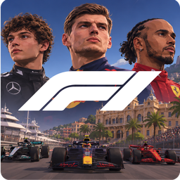
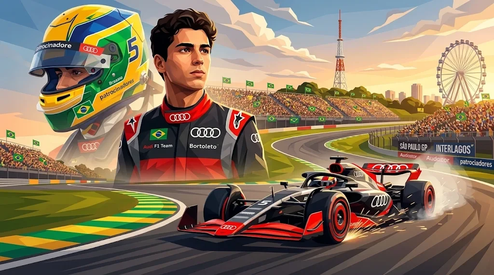
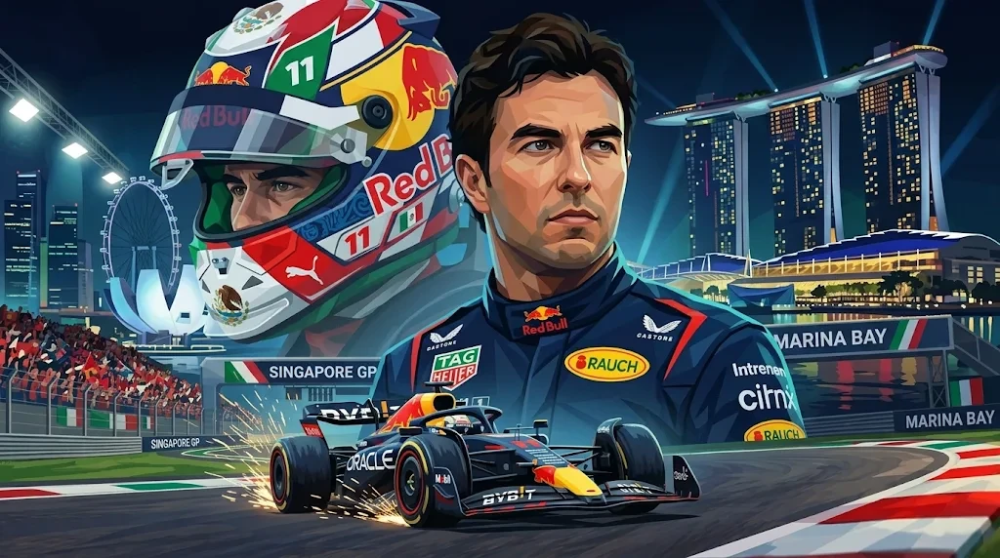
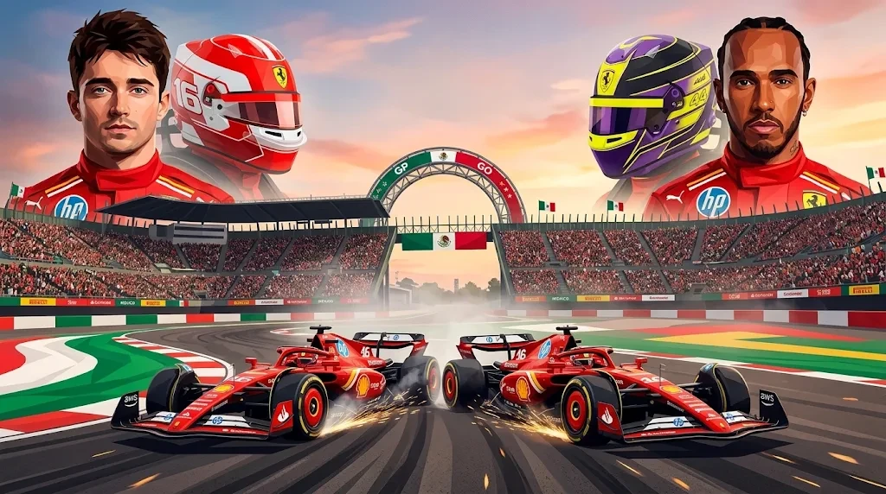

<p align="center">
  
</p>

<h1 align="center">Corrida da Galera</h1>

<p align="center"><b>Fórmula 1 com os amigos, no navegador ou instalado no PC.</b><br>
Grid de 22 carros, as equipes e os pilotos de 2026, 25 pistas, carreira, safety car, box, chuva e ERS.</p>

<p align="center">
  <a href="https://viladotabba.com/corrida/"><b>▶ Jogar agora no navegador</b></a> ·
  <a href="https://github.com/thiagoaqno/viladotabba/releases/download/programa-pc/CorridaDaGalera-Setup.exe"><b>⬇ Baixar para Windows</b></a> ·
  <a href="https://viladotabba.com/">A Vila da Galera</a>
</p>

<p align="center"></p>

---

## O que tem no jogo

- **Corrida rápida** contra 21 robôs, com três níveis, clima aleatório, seco, chuva ou variável, e classificação opcional (Q1, Q2 e Q3).
- **Carreira solo**: escolha a equipe, desenvolva o carro peça por peça, contrate pilotos e engenheiros e dispute o campeonato.
- **Temporada com os amigos**: cada um na sua equipe (dois podem dividir a mesma), mercado disputado, e quem chega depois entra numa equipe com vaga no meio da temporada.
- **Multiplayer**: abra uma sala, mande o link e corram juntos, com robôs completando o grid.
- **Contrarrelógio e treino livre**, com o fantasma da sua melhor volta e o acerto do carro liberado.
- **Regras de F1 de verdade**: pneus que gastam e esquentam, pit stop com a equipe de mecânicos, DRS, ERS manual, bandeiras, limites de pista, punições, safety car e a transmissão de TV antes da largada.
- **Acerto do carro** (asa e altura) por pista, com a proposta do engenheiro e a sugestão do estrategista.
- **Câmeras** de cockpit, T-cam, bico, de fora e de TV, com retrovisores e o retrovisor virtual.
- **Volante e controle**: tudo remapeável, força no volante nos Logitech (G25, G27, G29, Driving Force) e vibração no controle.
- **Configurações como nos jogos**: predefinições gráficas (e a personalizada), resolução, sombras, efeitos, áudio por canal e o painel compacto em primeira pessoa.

<p align="center">
  
  
  
</p>
<p align="center">
  
  
  
</p>

## Jogar

### No navegador
Abra **https://viladotabba.com/corrida/**, escreva o seu nome e escolha o modo. Funciona no Chrome e no Edge, no computador. No celular, dá para jogar com os botões na tela.

### Instalado no Windows (mais leve e sem ping jogando sozinho)
1. Baixe o **[CorridaDaGalera-Setup.exe](https://github.com/thiagoaqno/viladotabba/releases/download/programa-pc/CorridaDaGalera-Setup.exe)**.
2. Abra o arquivo. Se o Windows mostrar "O Windows protegeu o computador", clique em **Mais informações → Executar assim mesmo** (o programa não tem a assinatura paga da Microsoft).
3. **Avançar → Instalar**. Não pede senha de administrador.

O programa roda o jogo no próprio PC:
- **Sozinho** (corrida rápida, contrarrelógio, treino e carreira solo): roda inteiro no seu computador, sem ping, e funciona até sem internet.
- **Com os amigos**: entra nas salas do site, do mesmo jeito que quem joga pelo navegador.
- **Recordes**: os feitos sem internet sobem para o site quando a internet volta.
- **Atualizações**: ao abrir, o jogo pergunta antes de baixar e baixa só o que mudou.

## Rodar o código no seu PC

Precisa do **[Node.js](https://nodejs.org/) 24** (ou 22.13 em diante).

```bash
git clone https://github.com/thiagoaqno/viladotabba.git
cd viladotabba
npm ci
npm start
```

Abra **http://localhost:3000/corrida/**. Para jogar com alguém na mesma rede, use o IP do seu PC no lugar de `localhost`.

Variáveis úteis:
- `PORT`: a porta (3000).
- `DB_PATH`: o banco SQLite (`./dados/galera.db`; `:memory:` para um banco descartável).
- `CORRIDA_SITE`: o site a que o programa de PC se liga.

**Testes da Corrida:** `npm run test:corrida` (o `npm test` roda os de todos os jogos).

## Como o código está organizado

| Onde | O quê |
|---|---|
| `server.js` | Express + Socket.io: serve o site e abre os canais de cada jogo |
| `corrida*.js` | O servidor da Corrida: salas, robôs, física com autoridade do servidor, direção de prova, classificação e carreira |
| `public/corrida/` | O jogo no navegador (Three.js, sem etapa de build): pistas, carros, HUD, câmeras, sons e menus |
| `public/corrida/pistas.js` e `gps/` | O traçado e a configuração de cada GP; `kit/` tem as peças de cenário |
| `desktop/` | O programa de PC (o lançador e o instalador, montados pela action "Programa de PC") |
| `migracoes/` | O banco SQLite, uma migração por arquivo |

Um mapa mais detalhado está em [`CLAUDE.md`](CLAUDE.md) e em [`docs/mapa-completo.md`](docs/mapa-completo.md).

## A Vila da Galera

A Corrida mora dentro da **[Vila da Galera](https://viladotabba.com/)**, um site de jogos com os amigos que também tem futebol (carreira de treinador, futsal, pelada 3D), jogos de mesa (Uno, Truco, Dominó, Banco, Ludo, Sinuca) e mais. O próximo passo é a Vila virar um **GP de F1**: as casinhas de cada jogo ao redor de um circuito, com os carrinhos correndo enquanto a galera escolhe o que jogar.

---

<p align="center"></p>
<p align="center"><sub>Um jogo feito entre amigos, sem fins comerciais. Fórmula 1, F1 e os nomes das equipes e dos pilotos pertencem aos seus donos.</sub></p>
